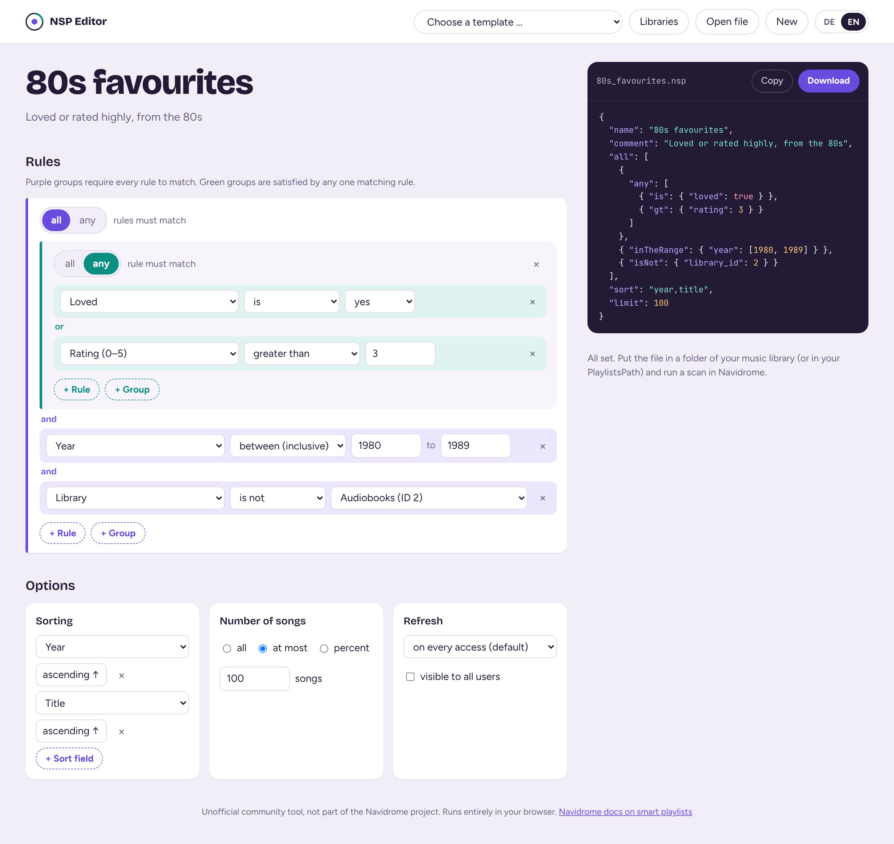

# NSP Editor for Navidrome

A visual editor for [Navidrome](https://www.navidrome.org/) smart playlists. Click your rules together, see the resulting `.nsp` file live, and download it. Everything runs in your browser – no server, no install, no account.

**Try it:** https://jonasmapache.github.io/navidrome-nsp-editor/

> Unofficial community tool. Not affiliated with or endorsed by the Navidrome project.

## Features

- **Nested rule groups.** Combine "all of" and "any of" groups as deep as you need, e.g. *(loved OR rating > 3) AND year 1980–1989*.
- **Inputs that fit the field.** Number fields offer greater/less than and ranges, date fields offer "in the last N days" or a date picker, yes/no fields a simple switch. Invalid combinations can't be built.
- **All fields and operators** from the official documentation, including album and artist fields, MusicBrainz IDs, custom tags, `isMissing` / `isPresent` and references to other playlists.
- **Sorting, limits and refresh.** Multi-field sorting, a song count or percentage limit, and `refreshDelay` for "daily mix" style playlists.
- **Open existing `.nsp` files** via button or drag and drop – comments and trailing commas are tolerated. Rules the editor doesn't know are kept as editable JSON instead of being dropped.
- **Your libraries by name.** Add your Navidrome libraries once (name + ID) and pick them from a list. Stored only in your browser.
- **Templates** for common playlists: Top 100, Daily Mix, Recently played, Loved songs, Recently added albums, Rediscover, Never played, and a nested example.
- **Live validation** with hints for missing values or inverted ranges.
- **English and German** interface.

## Usage

1. Open the editor ([online](https://jonasmapache.github.io/navidrome-nsp-editor/) or locally, see below).
2. Pick a template or start with **New**, then build your rules.
3. Click **Download** to save the `.nsp` file.
4. Put the file in any folder of your music library (or in the folder set as `PlaylistsPath`) and run a library scan in Navidrome. `AutoImportPlaylists` must be enabled, which is the default.

To change a playlist later, open the `.nsp` file in the editor, adjust it, save it over the old file and scan again.

**Finding IDs:** a library's ID is shown at the end of the address bar when you open it in Navidrome under *Settings → Libraries* (`…/library/2`). A playlist's ID is the last part of the address bar when you open the playlist.

See the [Navidrome documentation on smart playlists](https://www.navidrome.org/docs/usage/features/smart-playlists/) for details on fields, operators and behaviour.

## Run locally

Download or clone the repository and open `index.html` in your browser. Keep the `fonts` folder next to it; without it, the editor falls back to your system fonts and still works.

## Host it yourself with GitHub Pages

1. Fork this repository.
2. Go to **Settings → Pages**.
3. Under *Build and deployment*, choose **Deploy from a branch**, select `main` and `/ (root)`, and save.
4. After a minute, the editor is live at `https://<your-username>.github.io/navidrome-nsp-editor/`.

Any other static web server works too – it's just one HTML file and three font files.

## Privacy

The editor makes no network requests: fonts are bundled, there is no tracking and no analytics. Your language choice and library list are saved in your browser's local storage and never leave your device.

## License

[MIT](LICENSE) © jonasmapache. The bundled fonts are licensed under the SIL Open Font License, see [fonts/OFL.txt](fonts/OFL.txt).

---

## Deutsch

Ein grafischer Editor für Smart Playlists in [Navidrome](https://www.navidrome.org/). Du klickst die Regeln zusammen, siehst die fertige `.nsp`-Datei live und lädst sie herunter. Alles läuft im Browser, ohne Server, Installation oder Konto.

**Direkt ausprobieren:** https://jonasmapache.github.io/navidrome-nsp-editor/

> Inoffizielles Community-Tool, kein Teil des Navidrome-Projekts.

### Funktionen

- **Verschachtelte Gruppen** aus „alle“- und „mindestens eine“-Verknüpfungen, beliebig tief, z. B. *(mit Herz ODER Bewertung > 3) UND Jahr 1980–1989*.
- **Passende Eingaben je Feld:** Zahlenfelder mit größer/kleiner und Bereichen, Datumsfelder mit „in den letzten X Tagen“ oder Datumswähler, Ja/Nein-Felder mit Auswahl. Ungültige Kombinationen lassen sich nicht bauen.
- **Alle Felder und Operatoren** aus der offiziellen Doku, inklusive Album- und Interpretenfeldern, MusicBrainz-IDs, eigenen Tags, `isMissing` / `isPresent` und Verweisen auf andere Playlists.
- **Sortierung, Limit und Aktualisierung:** mehrere Sortierfelder, Begrenzung nach Anzahl oder Prozent und `refreshDelay` für Playlists wie einen Daily Mix.
- **Bestehende `.nsp`-Dateien öffnen** per Button oder Drag & Drop. Kommentare und überzählige Kommas werden toleriert, unbekannte Regeln bleiben als bearbeitbares JSON erhalten.
- **Bibliotheken mit Namen:** einmal mit Name und ID eintragen und danach aus einer Liste wählen. Gespeichert wird nur im eigenen Browser.
- **Vorlagen** für typische Playlists und eine **Live-Prüfung** mit Hinweisen auf fehlende Werte.
- Oberfläche auf **Deutsch und Englisch**.

### Benutzung

1. Editor öffnen ([online](https://jonasmapache.github.io/navidrome-nsp-editor/) oder lokal).
2. Vorlage wählen oder mit **Neu** beginnen und Regeln zusammenstellen.
3. Mit **Herunterladen** die `.nsp`-Datei speichern.
4. Die Datei in einen beliebigen Ordner der Musikbibliothek legen (oder in den `PlaylistsPath`) und in Navidrome einen Scan starten.

**IDs finden:** Die ID einer Bibliothek steht am Ende der Adresszeile, wenn du sie in Navidrome unter *Einstellungen → Bibliotheken* öffnest (`…/library/2`). Die ID einer Playlist ist der letzte Teil der Adresszeile in der Playlist-Ansicht.

### Lokal nutzen und selbst hosten

Repository herunterladen und `index.html` im Browser öffnen, den Ordner `fonts` daneben lassen. Für GitHub Pages: Repository forken, unter **Settings → Pages** „Deploy from a branch“ mit `main` und `/ (root)` wählen.

### Datenschutz

Der Editor stellt keine Verbindungen ins Internet her: Schriften sind eingebettet, es gibt kein Tracking. Sprache und Bibliotheksliste liegen nur im lokalen Speicher deines Browsers.
